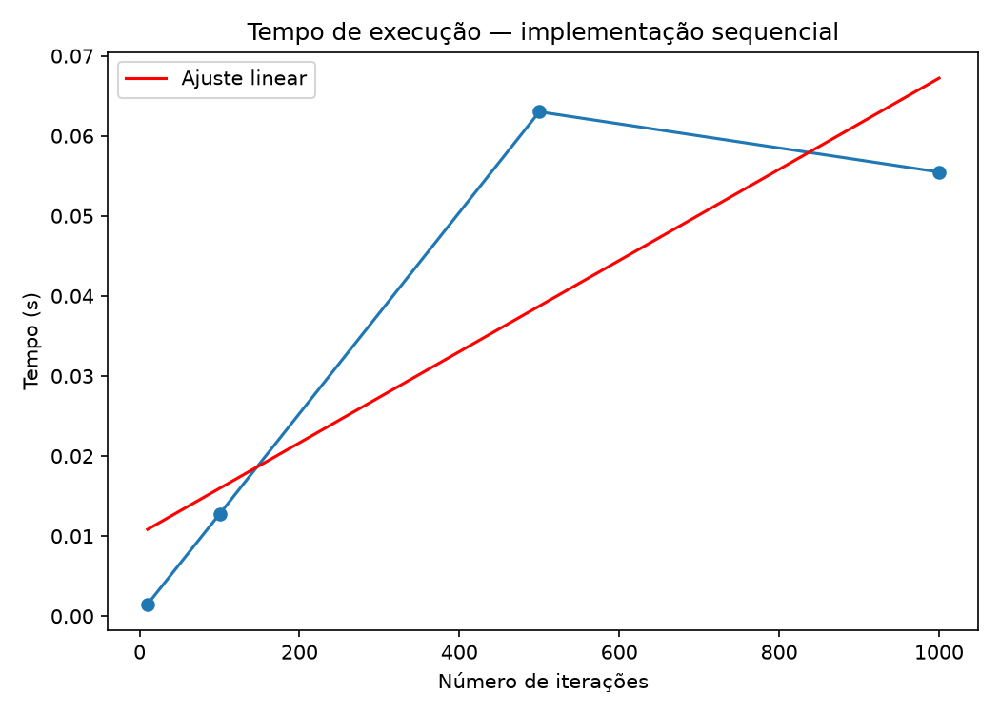
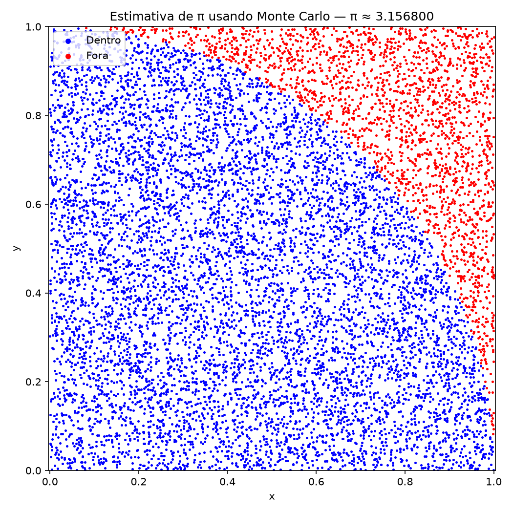
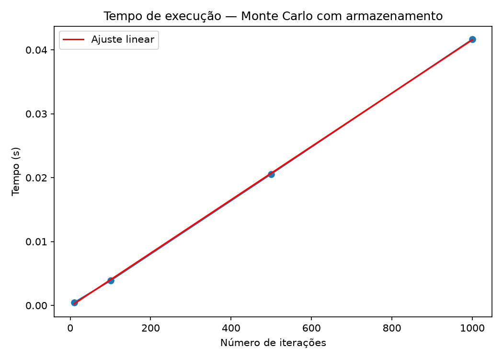
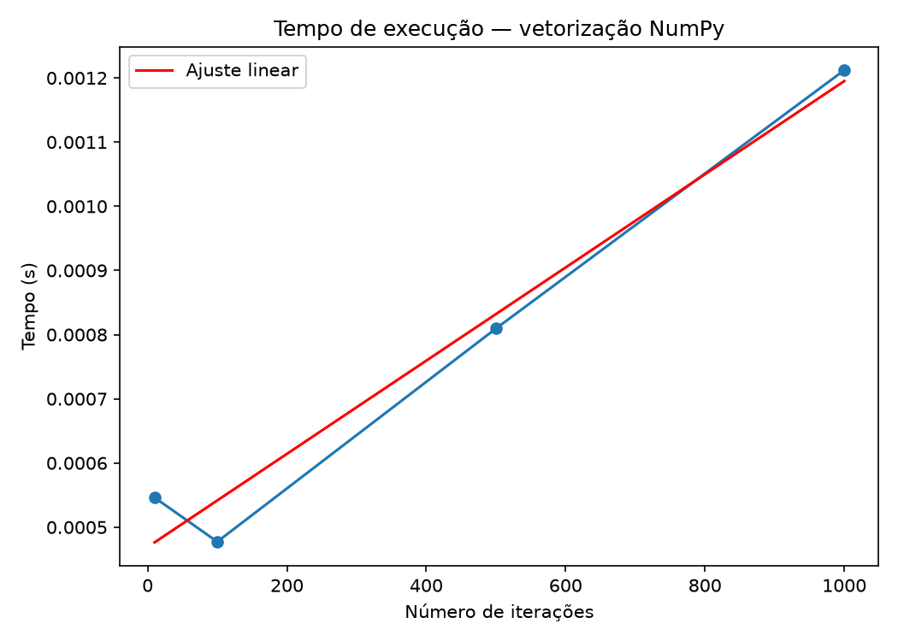
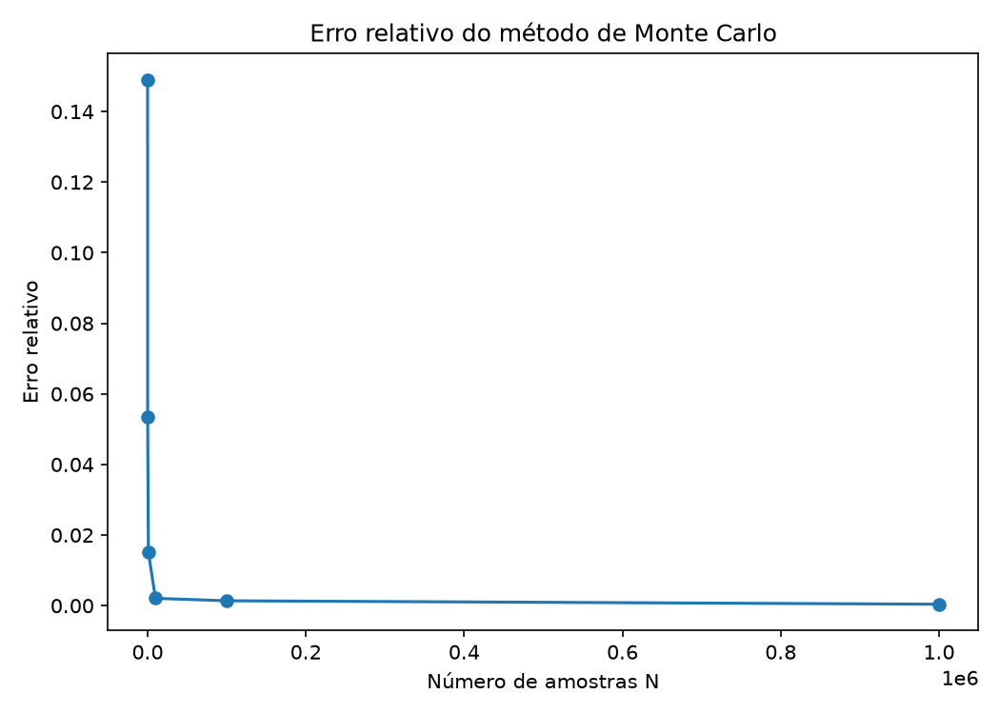
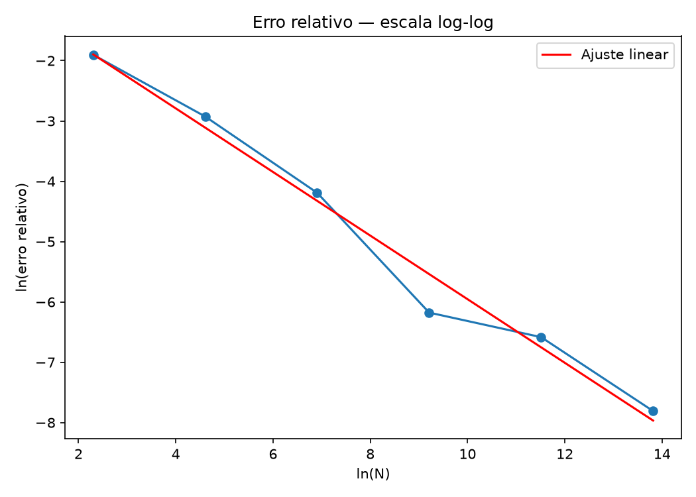
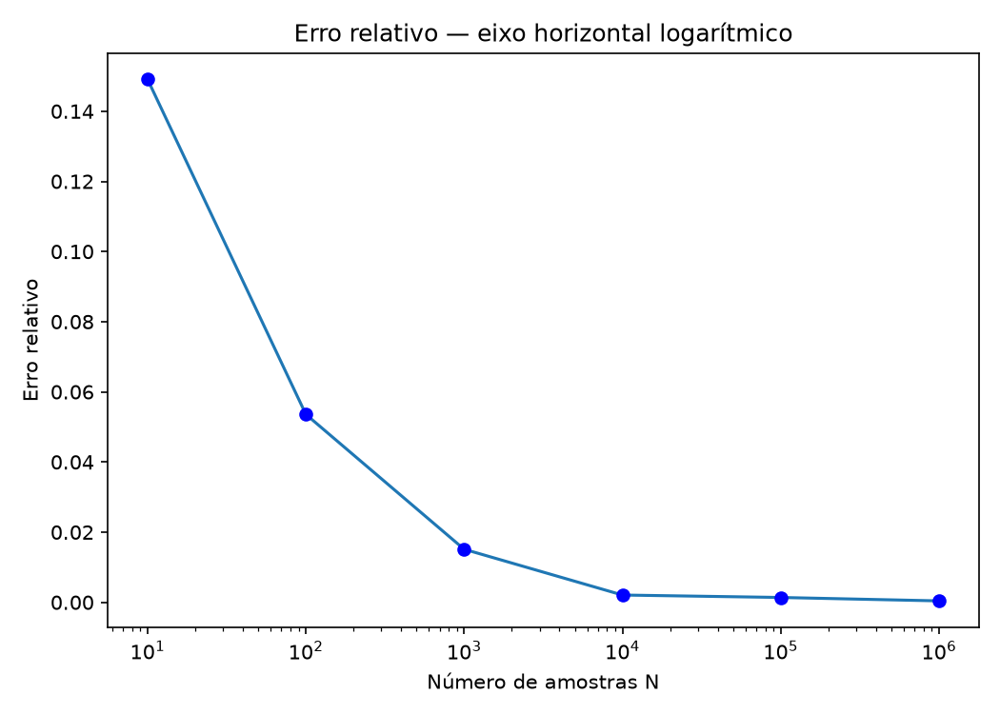

# Estimativa de $\pi$ pelo Método de Monte Carlo

## 1. Introdução e objetivo

Este relatório descreve as implementações desenvolvidas no notebook `lista1.ipynb` para a estimativa do número $\pi$ por meio do **Método de Monte Carlo**. Esta técnica utiliza amostragem aleatória para aproximar uma quantidade geométrica ou física cuja solução analítica pode ser conhecida, mas cuja avaliação numérica pode ser realizada por experimentos estatísticos.

As atividades foram organizadas em quatro questões. Nas duas primeiras são implementadas versões iterativas do método, sendo uma voltada principalmente à medição de tempo e outra ao armazenamento dos pontos. Na terceira questão, a implementação é vetorizada com NumPy. Por fim, na quarta questão, a precisão da estimativa é analisada em função do número de amostras.

O objeto de estudo é uma circunferência unitária inscrita em um quadrado de lado unitário. O método explora a relação entre suas áreas para estimar $\pi$:

$$
A_{\text{círculo}}=\pi r^2=\pi,
$$

$$
A_{\text{quadrado}}=1^2=1,
$$

pois o raio considerado é $r=1$. Assim, a razão entre as áreas corresponde a $\pi/4$.

## 2. Princípio matemático

A coordenada de cada amostra é sorteada independentemente no intervalo $[0,1]$, resultando em pontos uniformemente distribuidos no quadrado unitário:

$$
(x,y)\in[0,1]\times[0,1].
$$

Um ponto pertence ao quarto de círculo de raio unitário quando satisfaz:

$$
x^2+y^2\leq 1.
$$

Dessa forma, a probabilidade de gerar um ponto dentro da região corresponde a:

$$
P=\frac{A_{\text{círculo}}}{A_{\text{quadrado}}}
=\frac{\pi r^2}{(2r)^2}
=\frac{\pi}{4},
$$

porque somente um quarto do círculo está contido no primeiro quadrante. Se $N$ pontos são sorteados e $C$ deles estão dentro da circunferência, a frequência relativa dentro do círculo pode ser usada como estimador:

$$
\frac{C}{N}\approx\frac{\pi}{4},
$$

portanto,

$$
\boxed{\pi_{\text{MC}}=\frac{4C}{N}}.
$$

## 3. Variáveis e relações utilizadas

| Variável | Significado no código | Unidade ou natureza |
|---|---|---|
| `n` ou `N` | Número total de pontos aleatórios gerados | Inteiro adimensional |
| `x`, `y` | Coordenadas sorteadas no primeiro quadrante | Números reais em $[0,1]$ |
| `c` ou `dentro` | Quantidade de pontos para os quais $x^2+y^2\leq1$ | Contagem inteira |
| `fora` | Quantidade de pontos fora do quarto de círculo | Contagem inteira |
| `raio` | Vetor contendo $x^2+y^2$ em cada amostra | Vetor de números reais |
| `verificação` | Quantidade de elementos de `raio` menores ou iguais a 1 | Contagem inteira |
| `estimativa_pi` ou `calculo_pi` | Aproximação obtida por $4C/N$ | Número real |
| `pontosdentro` | Coordenadas dos pontos dentro da região circular | Matriz de duas dimensões |
| `pontosfora` | Coordenadas dos pontos fora da região circular | Matriz de duas dimensões |
| `tempo` / `tempoexec` | Tempo acumulado ou medido para diferentes tamanhos amostrais | Segundos |
| `valores_n` | Conjunto de valores de $N$ utilizados nos testes | Lista de inteiros |
| `Erro` | Erro relativo médio em relação ao valor real de $\pi$ | Número real adimensional |
| `r` | Índice das repetições usadas para calcular o erro médio | Inteiro |
| `E` | Acumulador do erro relativo em uma dada quantidade de amostras | Número real |
| `a` | Inclinação do ajuste linear no espaço log-log | Número real |
| `b` | Intercepto do ajuste linear no espaço log-log | Número real |
| `N_continuo` | Sequência densa usada para representar a reta ajustada | Vetor de números reais |

O erro relativo empregado na quarta questão é

$$
E(N)=\frac{|\pi-\pi_{\text{MC}}(N)|}{\pi}.
$$

Esse erro é adimensional e permite comparar estimativas obtidas em escalas diferentes de $N$.

## 4. Questão 1 — Implementação sequencial

A primeira implementação percorre as $n$ amostras com um laço `for`. Em cada iteração, são sorteados os valores `x` e `y`, independentemente, por `rng.rand()`. A condição

```python
if x*x + y*y <= 1:
```

computa a pertença ao quarto de círculo sem necessidade de calcular uma raiz quadrada. Isto é suficiente porque $x^2+y^2\leq1$ equivale a $r\leq1$.

A função `pi_monte_carlolento(n)` utiliza o contador `c` para determinar o número de acertos e retorna `4*c/n`. Em seguida, o notebook mede o tempo de 100 execuções para cada valor de

$$
N\in\{10,100,500,1000\}.
$$

A função `timeit.timeit` mede o tempo total de repetição, reduzindo a influência de pequenas variações do sistema. O gráfico relaciona o tamanho da amostra ao tempo de execução e inclui um ajuste linear obtido com `np.polyfit`.



A tendência linear é esperada: a função executa uma operação probabilística por amostra e, portanto, seu custo teórico cresce proporcionalmente a $N$. A curva apresentada é uma medida empírica da implementação, não apenas da complexidade matemática.

## 5. Questão 2 — Separação dos pontos e visualização

A segunda versão implementa a função `pi_monte_carlo(n, retorna_ponto=False)`. Além de contar os pontos internos, ela também pode armazenar suas coordenadas em `pontosdentro` e `pontosfora`.

Os pontos classificados como internos são representados em azul, enquanto os externos são representados em vermelho:



A imagem também permite compreender geometricamente o processo. Os pontos azuis tendem a ocupar o interior do quarto de círculo centrado na origem, enquanto os pontos vermelhos ocupam a região triangular excedente do quadrado. O valor estimado mostrado no título depende da realização aleatória particular da geração dos pontos.

Com $n=10000$, por exemplo, a reprodução utilizada para gerar as imagens obteve

$$
\pi_{\text{MC}}\approx3{,}1568,
$$

para uma semente aleatória fixa. Como o sorteio é aleatório, a execução sem controle da semente pode produzir outro valor próximo de $\pi$. Aumentar $N$ tende a diminuir a variação do resultado.

Esta implementação também mede o tempo para os mesmos valores de `valores_n`. O armazenamento das coordenadas ocupa memória adicional e exige anexar elementos às listas durante o laço.



## 6. Questão 3 — Implementação vetorizada

Na terceira questão, o sorteio das coordenadas deixa de ocorrer elemento a elemento dentro de um laço Python. A função `pi_monte_carlorapido(n)` cria vetores inteiros por meio de:

```python
x = rng.rand(n)
y = rng.rand(n)
```

Em seguida, a expressão

```python
raio = x*x + y*y
verificação = np.sum(raio <= 1)
```

calcula simultaneamente todas as distâncias ao quadrado e conta os resultados verdadeiros da comparação. Esta representação é vetorizada pelo NumPy e delega operações repetidas a rotinas internas mais eficientes.



Embora tanto o código vetorizado quanto os loops tenham complexidade assintótica $O(N)$, a implementação vetorizada pode ser mais rápida em uma execução real. Isso ocorre porque o loop principal é executado dentro de operações compiladas, com menor sobrecarga do interpretador Python. Contudo, vetorização não altera a natureza estatística do método: ela apenas acelera a geração e a avaliação dos pontos.

## 7. Questão 4 — Análise do erro

Na quarta questão, o notebook avalia o método para:

$$
N\in\{10,10^2,10^3,10^4,10^5,10^6\}.
$$

Para cada valor de $N$, são feitas $r=10$ realizações independentes da estimativa. Em cada realização:

1. `pi_monte_carlorapido(n)` gera uma nova estimativa;
2. o módulo da diferença entre $\pi$ e a estimativa é dividido por $\pi$;
3. os dez erros relativos são somados;
4. a soma é dividida por 10, armazenando-se a média em `Erro`.

Matematicamente, o procedimento implementado é:

$$
E(N)=\frac{1}{10}\sum_{r=1}^{10}
\frac{|\pi-\pi_{\text{MC},r}(N)|}{\pi}.
$$

### 7.1 Evolução do erro

O gráfico abaixo mostra o erro relativo médio em função de $N$:



Observa-se uma redução geral do erro à medida que o número de pontos cresce. Essa conclusão é coerente com a Lei dos Grandes Números: conforme $N$ aumenta, a frequência relativa $C/N$ tende à probabilidade teórica $\pi/4$.

### 7.2 Escala logarítmica

Como os valores de $N$ e do erro abrangem diferentes ordens de grandeza, o notebook aplica o logaritmo natural aos dados:

$$
\ln E=a\ln N+b.
$$

`np.polyfit(np.log(N), np.log(Erro), 1)` calcula os coeficientes $a$ e $b$. A inclinação $a$ representa o expoente aproximado da relação de escala:

$$
E(N)\propto N^a.
$$

A reprodução usada neste relatório produziu aproximadamente:

$$
a\approx-0{,}527,
\qquad
b\approx-0{,}684.
$$

Esses valores são específicos da amostragem realizada e podem variar entre execuções. O valor teórico mais conhecido para o desvio típico da média Monte Carlo é proporcional a $N^{-1/2}$, isto é, $a=-1/2$. O ajuste obtido é compatível em ordem de grandeza, mas o cálculo usa apenas dez repetições e um conjunto limitado de tamanhos amostrais.



A reta vermelha representa o ajuste linear no espaço log-log. Ela não deve ser interpretada como uma demonstração analítica de convergência, mas como uma descrição empírica do comportamento observado.

### 7.3 Visualização em escala semilogarítmica

A última representação mantém o erro na escala linear e o número de amostras na escala logarítmica:



Essa escala evidencia melhor a variação do erro ao longo de $10^1$ até $10^6$. Também permite verificar a queda ao longo de várias ordens de grandeza sem distorcer o eixo vertical usado para o erro relativo.

## 8. Discussão física e estatística

Embora o problema seja geométrico, a base estatística utilizada é semelhante à de muitos experimentos físicos. Em uma simulação Monte Carlo, um grande número de eventos aleatórios representa um ensemble de possíveis realizações do sistema. As incertezas surgem da amostragem finita, assim como incertezas experimentais podem surgir de medidas limitadas ou flutuações do processo.

A convergência não é determinística para um conjunto fixo de amostras. A estimativa pode ficar temporariamente acima ou abaixo de $\pi$. Após muitas realizações, a distribuição das estimativas tende a se concentrar em torno do valor verdadeiro.

Para uma média de Bernoulli com probabilidade $p=\pi/4$, a variância teórica é:

$$
\sigma^2_{C/N}=\frac{p(1-p)}{N}.
$$

Por isso, o desvio padrão da frequência relativa deve decrescer aproximadamente como:

$$
\sigma\propto N^{-1/2}.
$$

Consequentemente, para reduzir o desvio por um fator $10$, é necessário aumentar o número de amostras aproximadamente por um fator $100$. Esse é um ponto central da relação custo-benefício do método.

## 9. Comparação das implementações

| Aspecto | Versão lenta | Versão com pontos | Versão vetorizada |
|---|---|---|---|
| Estrutura | `for` em Python | `for` em Python | Vetores NumPy |
| Gera coordenadas | Uma por vez | Uma por vez | Vetores completos |
| Conta pontos | Incremento manual | Incremento manual | `np.sum` |
| Armazena pontos | Não | Sim | Não |
| Uso de memória | Baixo | Maior | Vetores temporários |
| Eficiência prática | Menor | Menor, com custo adicional | Maior |
| Finalidade principal | Demonstrar o método | Visualização geométrica | Cálculos rápidos |

As três estratégias representam o mesmo algoritmo probabilístico. As diferenças estão principalmente no custo computacional e na quantidade de informação armazenada. Para uma simples estimativa estatística, a versão vetorizada é a mais adequada. Quando o objetivo é visualizar ou analisar cada amostra, o armazenamento das coordenadas torna-se necessário.

## 10. Considerações finais

O método de Monte Carlo permitiu estimar $\pi$ por meio de amostras aleatórias uniformes em uma região geométrica simples. A relação central utilizada foi:

$$
\frac{C}{N}\approx\frac{\pi}{4}
\quad\Rightarrow\quad
\pi_{\text{MC}}\approx\frac{4C}{N}.
$$

O estudo demonstrou três aspectos:

- a estimativa converge para $\pi$ à medida que o número de pontos aumenta;
- o tempo de execução cresce aproximadamente de forma linear com $N$;
- o erro relativo tende a diminuir com uma lei próxima de $N^{-1/2}$;
- a vetorização reduz a sobrecarga computacional sem modificar o princípio físico e estatístico.

Como limitações, a análise de erro foi realizada com apenas dez repetições para cada número de amostras e os tempos medidos dependem do hardware e da carga do sistema. Portanto, os gráficos representam tendências empiricamente verificadas no ambiente utilizado, não resultados universais exatos.

## 11. Dependências utilizadas

- **NumPy:** geração aleatória, operações vetoriais, ajustes polinomiais e operações logarítmicas;
- **Matplotlib:** geração dos gráficos;
- **SciPy:** biblioteca importada no notebook, mas não utilizada diretamente nas funções apresentadas;
- **timeit:** medição do tempo de execução das implementações;
- **Jupyter Notebook:** ambiente usado para desenvolvimento e execução das células.
